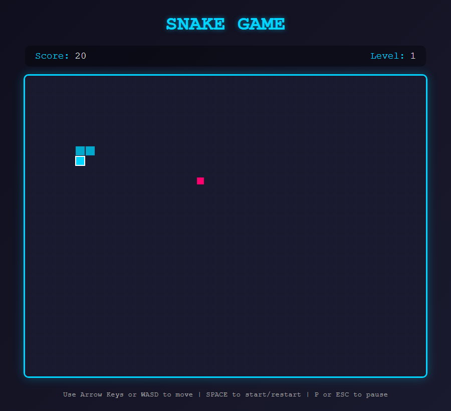

# Snake Game

[](https://github.com/SamaadTurner/snake-game/actions/workflows/deploy.yml)

A Snake game written in plain JavaScript on an HTML canvas. No frameworks.

**Play it here: https://samaadturner.github.io/snake-game/**



I built this mainly to practice testing. The game itself is small, so most of the
work went into the test suite and getting it to run in CI.

## How to play

- `SPACE` starts or restarts the game
- Arrow keys or `WASD` move the snake
- `P` or `ESC` pauses
- Eating food adds 10 points. The snake speeds up as the score goes up (10 levels).
- Hitting a wall or yourself ends the game

## Run it locally

You need Node 20 or newer.

```bash
git clone https://github.com/SamaadTurner/snake-game.git
cd snake-game
npm install
npm run serve
```

Then open http://localhost:8080.

## Tests

| Type | Count | Tool | What it covers |
|---|---|---|---|
| Unit | 95 | Vitest + jsdom | Collisions, input handling, food spawning, difficulty, game state |
| Integration | 51 | Vitest + jsdom | Movement, eating food, drawing to the canvas |
| End-to-end | 31 | Playwright | Real gameplay in Chromium, Firefox and WebKit (93 runs total) |

```bash
npm test                  # unit + integration
npm run test:unit
npm run test:integration

npx playwright install    # one time, downloads the browsers
npm run test:e2e
```

Every push to `main` runs all three sets in GitHub Actions. The site only deploys
if they pass.

### Things I ran into

- The end-to-end tests used to wait a fixed 150 ms after a key press and then check
  the snake's direction. That failed once in a while because a key press only takes
  effect on the next game tick. They now wait until the direction actually changes.
- Food spawns at a random spot, so a test that "plays" until it eats food can lose.
  The test now puts the food right in front of the snake first.
- The game runs from a plain `<script>` tag, so the unit tests load `index.html`
  into jsdom and read the game through a small `window.testAPI` object.

## Files

```
index.html     page markup
styles.css     styling
game.js        all game logic
server.js      small static file server for local use and e2e tests
tests/unit, tests/integration, tests/e2e
```

## License

MIT
